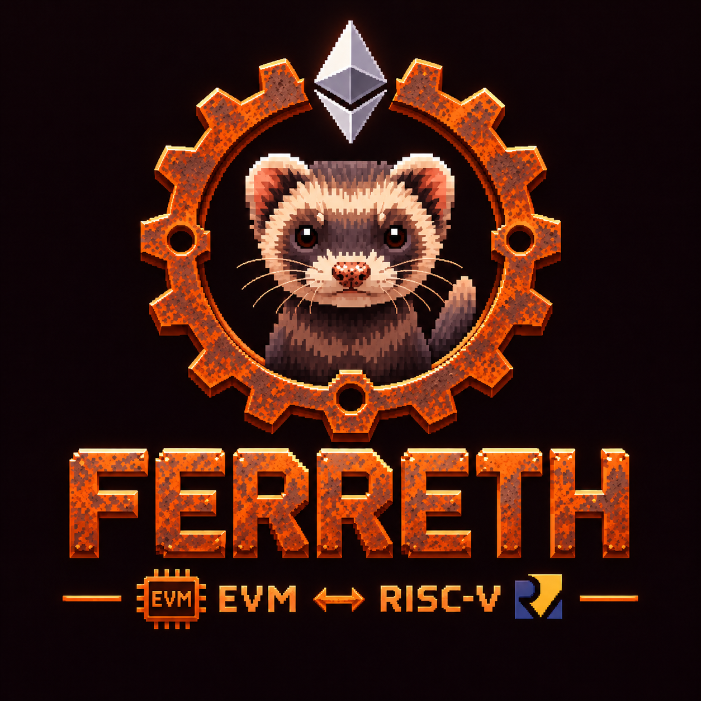

<p align="center">
  
</p>

<div align="center">


# An experimental EVM-to-RISC-V compiler.

*Built for open architectures, reproducible research, and hardware exploration.*

</div>

## Why Ferreth?

We believe the future of computing should be built on **open architectures**.

Ferreth explores whether Ethereum Virtual Machine (EVM) bytecode can be compiled into RISC-V instructions while preserving EVM execution semantics.

Our long-term ambition is to investigate a universal EVM-to-RISC-V compilation approach, independent of any particular processor implementation, emulator, or hardware platform.

By combining the EVM's execution model with RISC-V's open instruction set architecture, we hope to make Ethereum-oriented execution more accessible to researchers, compiler engineers, and hardware enthusiasts.

Ferreth v0.1.0 is an experimental compiler for bounded, straight-line EVM
bytecode. It emits an RV64 guest and supports `STOP`, `PUSH1`, `POP`, `DUP1`,
`ADD`, and `SUB`.

## How It Works

```text
EVM bytecode → decoding and lowering → symbolic RV64 fragments
→ composition and assembly → final-image verification
→ rvemu execution → ADR-001 result validation
```

The public whole-program route performs stack operations and arithmetic in
generated RV64 code. Rust initializes the guest and validates its published
result. [Guest linking architecture](docs/research/ferreth-guest-linking.md) ·
[ADR-001 guest ABI](docs/adr/001-evm-guest-state-abi.md)

The architecture separates compilation from execution through a backend-neutral interface, allowing future experiments with other emulators or native RISC-V hardware.

## Current Status

Ferreth is in early development.

| Component | Status |
|---|---|
| EVM bytecode decoding | Partial |
| RV64 code generation | Experimental |
| STOP, PUSH1, POP, DUP1, ADD, SUB | Implemented |
| Guest stack and runtime ABI | Implemented |
| Whole-program RV64 execution | Implemented for supported opcodes |
| Differential validation against REVM Cancun | Directed and seeded tests for termination and successful stacks |
| Additional EVM opcodes | Planned |
| Alternative RISC-V backends | Future research |
| RTL and hardware acceleration | Future research |

Execution ends at the first `STOP` or the end of bytecode. Dynamic EVM control
flow, EVM memory and storage operations, and EVM gas metering are unsupported.
Ferreth makes no general EVM conformance, formal correctness, or
production-safety claim.

The guest stack holds up to 1,024 words, and the executable image is capped at
1,048,572 bytes. Assembler resource limits can reject a program even when its
image would fit. [Capacity evidence](docs/research/ferreth-guest-linking.md#accepted-limits-and-pending-phase-3-work)

## Getting Started

The recorded cutover checks used Rust and Cargo 1.98.1 on
`aarch64-apple-darwin`. Use the checked-in `Cargo.lock` with `--locked`.
The compiler uses `alloy-primitives` 1.7.3, `asm-rs` 0.2.0, and `rvemu`
0.0.11. The separate `ferreth-conformance` crate uses REVM 43.0.3
with `revm-interpreter` 43.0.2 resolved in the lockfile.
[Lockfile](Cargo.lock) · [Cutover evidence](research/guest-linking/phase-2.4-public-cutover.md)

From the repository root, run the test suite:

```bash
cargo test --locked --workspace
```

The default `cargo test --locked` command runs compiler tests only. Run
`cargo test --locked -p ferreth-conformance` for the REVM differential suites.

Execute a simple EVM program:

```bash
cargo run --locked -p ferreth-compiler -- execute --bytecode 600560030100
```

This program computes `5 + 3` using EVM `PUSH1`, `ADD`, and `STOP` instructions, producing a final stack containing `8`.

Inspect the standalone RV64 ADD routine:

```bash
cargo run --locked -p ferreth-compiler -- translate --op ADD
```

Run the arithmetic benchmarks with a working `dtc` on `PATH` for JSON
capture. [Benchmark stdout requirements](docs/runbooks/benchmark.md#json-stdout)

```bash
cargo run --locked -p ferreth-conformance -- \
  bench --op ALL --cases 1000 --seed 42 --format json
```

For more commands and examples:

- [CLI Runbook](docs/runbooks/cli.md)
- [Benchmark Runbook](docs/runbooks/benchmark.md)

## Research Directions

**EVM-to-RISC-V Compilation**

Expand opcode coverage, improve code generation, and investigate EVM semantic compatibility across different RISC-V execution environments.

**Conformance and Verification**

Develop reproducible differential tests and validation tools to compare compiled execution against established EVM implementations.

**Open Hardware Exploration**

Investigate native RISC-V execution, FPGA implementations, RTL designs, and potential Ethereum-oriented hardware acceleration.

No performance or efficiency advantage is assumed; these are questions to be investigated experimentally.

## Contributing

Ferreth is an open research effort, and contributions are welcome.

Whether you are interested in Rust, compilers, Ethereum, RISC-V, emulators, verification, or digital hardware design, there is room to explore.

You can contribute by improving opcode coverage, adding differential tests, reviewing architecture decisions, investigating execution backends, improving documentation, or proposing experiments.

Open an issue to discuss an idea, report a bug, or propose a research direction. Pull requests are welcome.

**You don't need to be an EVM or RISC-V expert to contribute. Curiosity and a willingness to experiment are enough.**

## License

Licensed under either of:

- [MIT License](LICENSE-MIT)
- [Apache License, Version 2.0](LICENSE-APACHE)

at your option.

---

*Ferreth — Exploring Ethereum execution through open instruction sets.*
