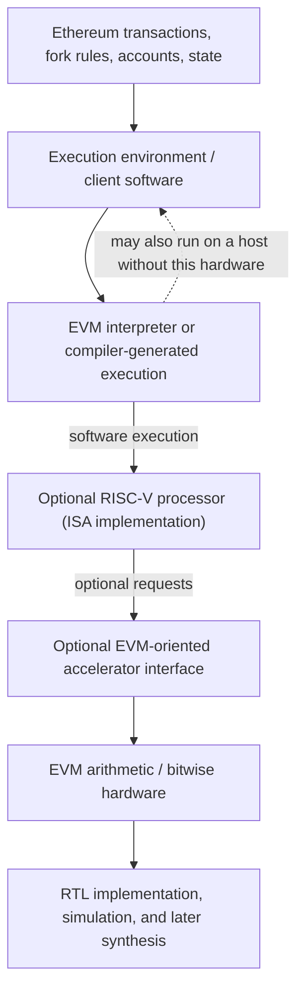

# Ferrum ETH Architecture

| Field | Value |
|---|---|
| Document type | Research architecture |
| Version | 0.3 |
| Status | Proposed; decisions are provisional unless marked as constraints |
| Date | 2026-11-16 |
| Scope | EVM-to-RISC-V translation, Ethereum-oriented hardware research, and supporting agent-workflow experiments |

### Change history

| Version | Summary |
|---|---|
| 0.3 | Established behavioral parity as the primary empirical objective; separated bytecode translation, hardware acceleration, and agent-workflow experiments; added an incremental research roadmap and clarified evidence claims. |
| 0.2 | Corrected the evm-asm reference; clarified RV64IM as a candidate, ETH-001's abstract combinational interface, ETH-004 reset decisions, and documentation precedence. |
| 0.1 | Initial research architecture. |

## 1. Executive Summary

Ferrum ETH's primary empirical objective is to investigate whether EVM behavior can be reproduced by execution translated to RISC-V, and under what conditions (if any) hardware specialization offers a measurable advantage. The two complementary research tracks are:

1. **EVM-to-RISC-V translation and behavioral parity:** begin with small EVM bytecode sequences translated to RV64IM; compare observable behavior with a pinned executable reference.
2. **Ethereum-oriented hardware acceleration:** compare conventional RV64IM implementations of EVM operations with separately specified RTL units and, later, possible accelerators.

These tracks are related but independently testable. ETH-001 remains the existing standalone 256-bit RTL and agent-orchestration experiment; its arithmetic contract is not an EVM bytecode translator or a full opcode implementation. Agent tournaments are an optional experimental methodology for comparing workflows, not the scientific objective.

Start translation research with bytecode, not Yul. A future Yul path may be studied through an intermediate representation, but Yul is not interchangeable with bytecode: parity requires identifying the exact compiled EVM program used as the reference. Ethereum specifications are normative; an execution client such as revm is an executable reference. Passing differential tests is empirical evidence for tested cases, not proof of universal correctness or complete Ethereum conformance.

Agent orchestration remains separate from execution semantics and is evaluated only when useful as a workflow experiment. This document records research goals, provisional architecture, verification strategy, and unresolved decisions. It does not define executable missions or claim measured performance, area, or correctness.

## 2. Vision, Goals, and Non-Goals

### 2.1 Vision and goals

Ferrum ETH will investigate whether:

- Small EVM bytecode programs can be translated to RV64IM while preserving their observable EVM behavior.
- Conventional RV64IM code and specialized hardware can implement selected EVM operations with measurable differences in cost under specified workloads.
- Specialized hardware's correctness, interface, and workload-dependent costs can be evaluated without assuming it is faster or more efficient.
- A disciplined local-agent workflow can design and review hardware without substituting agent claims for deterministic evidence.
- The research can be reproduced from versioned specifications, source, tool settings, and test inputs.

### 2.2 Research questions and hypotheses

| Question | Testable hypothesis |
|---|---|
| Can small EVM bytecode sequences be translated to RV64IM? | For a pinned EVM specification revision and executable reference, a documented translation of selected sequences can match the reference's applicable observable outputs on a declared differential test corpus. Report mismatches and untested behavior. |
| Can physical implementation be optimized without changing EVM gas behavior? | For selected bytecode and a named fork, a translation may reorder or eliminate native instructions while preserving the original bytecode's gas and other observable behavior, including `GAS` and out-of-gas cases where applicable. This is a test target, not an assumption that gas charges may be safely aggregated. |
| Does specialized hardware help selected workloads? | For a declared workload and accounting boundary, a specialized unit may show a measurable difference from conventional RV64IM multi-limb code in one or more specified metrics; the direction and significance are unknown until measured. |

These are bounded empirical hypotheses, not universal claims. Differential-test success is **empirical parity for tested cases**. **Specification conformance** is a claim against a named normative Ethereum specification and requires appropriate coverage. **Formal correctness** requires a stated property, model, assumptions, and proof boundary; neither differential testing nor implementation in a proof-oriented project implies it.

### 2.3 Five distinct engineering outcomes

The following are different deliverables and must not be conflated:

| Outcome | What it is | What it does not establish |
|---|---|---|
| EVM-to-RISC-V translation | A translation of a specified EVM bytecode program to a specified RISC-V profile, evaluated for observable parity | Equivalence for all programs, complete Ethereum conformance, or formal correctness |
| EVM arithmetic hardware | A hardware module implementing a defined subset of arithmetic or bitwise operations over 256-bit values | A processor, complete EVM, gas accounting, memory, or Ethereum state transition |
| RISC-V processor executing EVM software | A CPU implementing a specified RISC-V ISA that runs an interpreter or other EVM-related program | Native EVM opcodes, Ethereum consensus compatibility, or acceleration |
| RISC-V processor with Ethereum-specific acceleration | A RISC-V processor with a defined interface to one or more EVM-oriented operations | Full opcode semantics or complete execution-client behavior |
| Ethereum execution environment | Software and supporting components that implement the applicable Ethereum execution rules, state transitions, and interfaces | A consequence of having an arithmetic unit or RISC-V core |

These are separate milestones because they have different architectural boundaries, state, verification oracles, and compatibility requirements. A 256-bit adder alone does not interpret bytecode, manipulate an EVM stack, charge gas, access contract state, or apply transaction and fork rules.

### 2.4 Non-goals for the initial phase

- Claiming to implement a complete RISC-V CPU or Ethereum execution client.
- Choosing a pipeline, cache, bus protocol, memory hierarchy, or custom instruction encoding before requirements justify it.
- Assuming a hardware accelerator is faster, smaller, lower-energy, or more secure than software without measurements.
- Treating a zero-knowledge virtual machine as a physical processor architecture.
- Treating RTL simulation as synthesis, physical implementation, or fabrication.
- Treating existing EVM assembly, compiler, or zkVM projects as ready-made hardware designs.
- Claiming universal parity, complete Ethereum conformance, or formal correctness from finite differential tests.

## 3. Architecture Boundaries and Terminology

### 3.1 Terms

- **EVM word:** a 256-bit stack value used by the Ethereum Virtual Machine.
- **EVM bytecode:** the EVM instruction sequence executed by the virtual machine. A source language or IR such as Yul is not itself the bytecode reference.
- **EVM opcode semantics:** the complete behavior of an opcode, including operands, stack effects, exceptional conditions, memory or state effects, and gas rules where applicable.
- **Behavioral parity:** agreement on the applicable observable behavior for specified inputs and conditions; always qualify its tested scope.
- **Arithmetic unit:** a module that computes explicitly specified arithmetic or bitwise functions on operands. It need not contain architectural state.
- **RISC-V ISA:** the software-visible instruction-set contract implemented by a RISC-V processor.
- **Accelerator:** a hardware block invoked through a defined software-visible mechanism, such as a coprocessor interface, memory-mapped registers, or (if separately justified) a custom instruction.
- **Execution client/environment:** software and system components that apply Ethereum execution rules. A subset of arithmetic hardware is not an execution environment.
- **Mission:** a separately authorized work package. The four missions in Section 10 are roadmap descriptions, not executable specifications.

### 3.2 Architectural layers

The diagram is a set of possible layers, not a committed system topology. Early work may implement only the bottom arithmetic module and a testbench.

## 4. Hardware Architecture

### 4.1 Staged evolution

The hardware track is staged to keep interfaces and design choices reversible:

The hardware milestones are one track, not a prerequisite chain for translation research:

1. **Isolated combinational unit:** ETH-001 covers 256-bit ADD/SUB; other operations remain candidate work.
2. **Registered execution and integration studies:** define protocols and compare measured cost against software baselines.
3. **Optional processor or specialization:** select a precise ISA profile and consider accelerators or extensions only when workloads and measurements justify investigation.

In parallel, translation starts with small bytecode programs and their RV64IM equivalents (Section 11.5). No pipeline, cache, custom instruction, or accelerator microarchitecture is selected here.

The stages do not require a single implementation to grow into a monolithic design. A component may remain a standalone research result.

### 4.2 ISA requirements, microarchitecture, and implementation

| Category | Meaning in this project | Examples |
|---|---|---|
| ISA requirement | Externally observable software contract | RV64I behavior, and RV64M behavior only if that extension is selected |
| Microarchitectural choice | Internal organization that preserves the chosen contract | single- versus multi-cycle execution, forwarding, pipeline depth, accelerator scheduling |
| Implementation detail | RTL, synthesis, and physical realization choice | logic decomposition, target clock constraints, cell mapping, FPGA pin assignment |

The project must record which category a decision belongs to. An ISA-compatible CPU does not imply a particular microarchitecture; a block that supports an EVM operation does not define a RISC-V ISA extension.

### 4.3 RV64 and 256-bit values

RV64I provides a 64-bit integer register width (XLEN). RV64M is an optional standard extension for integer multiply/divide operations; it is not a 256-bit arithmetic extension. EVM arithmetic uses 256-bit words. Consequently, software on RV64 must represent one EVM word across multiple machine words or use another representation, while a dedicated datapath may accept 256-bit operands directly.

A natural software representation is four 64-bit limbs, but limb ordering, memory byte order, carry propagation, and calling conventions are implementation and interface decisions that must be written down when a software/RTL boundary is introduced. Four 64-bit limbs do not imply four RISC-V instructions. A 256-bit RTL port does not dictate that software storage layout. ETH-001 uses abstract 256-bit operands and a 256-bit result; it does not require an RV64 limb-based interface.

For the initial ADD and SUB operations, the result is modulo \(2^{256}\):

\[
\operatorname{ADD}(a,b)=(a+b)\bmod 2^{256}, \quad
\operatorname{SUB}(a,b)=(a-b)\bmod 2^{256}.
\]

The hardware must not report a wider mathematical result in place of the low 256 bits unless a future interface explicitly defines an extra carry or borrow output.

### 4.4 Computation and state

The first roadmap unit is combinational: for stable inputs, its outputs are a pure function of the selected operation and operands. It has no architectural state, request queue, clock, or reset. This makes its functional contract small, but does not establish timing closure or a target clock frequency.

ETH-004 is expected to introduce registered behavior, but this architecture does not mandate a reset model. Its mission must compare and choose a suitable option, such as synchronous or asynchronous reset, or a protocol with no reset if justified. The decision must state reset polarity and values when applicable, request acceptance, result-valid behavior, backpressure or overlapping requests, latency, and behavior during reset or cancellation. Selection criteria include integration needs, simplicity, determinism, verifiability, and the intended execution environment. No particular ready/valid protocol, pipeline, latency, or reset model is selected here. ETH-001 remains combinational and has no clock or reset.

### 4.5 Data movement, memory, and boundaries

An arithmetic unit should initially consume operands and return results through explicit ports. It should not directly read Ethereum storage, parse bytecode, or own system memory. A later accelerator integration must account for the cost and semantics of moving 256-bit operands, the host’s data representation, invocation overhead, and synchronization.

Memory-mapped, coprocessor-style, and custom-instruction interfaces have different tradeoffs (Section 6). No bus or address map is defined until an integrating subsystem has a concrete need.

### 4.6 Clock, reset, timing, and implementation

Combinational RTL has no clock domain; timing analysis still matters once it is synthesized or embedded in a clocked path. A registered unit needs an explicit clock/reset contract and must avoid ambiguous reset behavior. Timing targets, clock constraints, and reset implementation are open decisions for a target platform.

SystemVerilog is the proposed RTL language, and Verilator is the proposed simulation/lint tool based on the stated project direction. These are provisional tool choices, not proof of portability to every simulator or synthesis tool. Simulation validates modeled behavior against tests; synthesis estimates or maps hardware under tool and constraint assumptions. Neither operation alone demonstrates fabricated silicon or physical performance.

### 4.7 Hardware/software responsibility boundary

Hardware is responsible only for functions explicitly assigned to its module contract. Software is responsible for operations outside that contract, including dispatch, EVM stack management, operand extraction and writeback, byte-addressed memory, gas calculations, calls, persistent state, fork selection, and transaction-level behavior unless a later requirement deliberately moves a defined portion into hardware.

An accelerator that computes a numeric function is not automatically an implementation of the corresponding EVM opcode. Opcode-level behavior may additionally depend on stack underflow/overflow rules, memory ranges, state, exceptional halting, gas, and execution context. Translated code need not reproduce physical EVM stack operations instruction by instruction; it must preserve the observable semantics. Virtual EVM gas is independent of RISC-V instruction count, cycles, and elapsed time.

## 5. Ethereum Execution Semantics

### 5.1 Word arithmetic and signedness

EVM stack items are 256-bit words. Unsigned and signed operations share the same bit pattern but interpret it differently. Signed operations conventionally interpret the high bit as the sign bit of a two's-complement value; the bit pattern remains 256 bits. Arithmetic, division edge cases, shifts, and comparison behavior must be checked against the selected Ethereum execution-specification revision rather than inferred from a host language.

`ADD` and `SUB` wrap modulo \(2^{256}\). ETH-001 specifies these arithmetic functions explicitly and does not depend on a fork-specific opcode behavior. Their EVM word-arithmetic basis is described in the [Ethereum execution specifications](https://github.com/ethereum/execution-specs); a mission requiring fork-specific behavior must pin its exact specification revision. Comparison instructions such as `LT`/`GT` and `SLT`/`SGT` differ by unsigned versus signed interpretation. `EQ` is bitwise equality. A hardware comparator may implement the numerical comparison, but complete opcode behavior also includes stack effects and gas.

### 5.2 Stack and execution

The EVM is stack-based. Arithmetic opcodes consume and produce stack words according to their defined operand order; an implementation must not infer the order from a hardware port naming convention. The EVM also has stack-depth limits and exceptional behavior. Stack management and opcode dispatch remain software responsibilities in the initial architecture.

### 5.3 Keccak-256 and SHA3-256

Ethereum's `KECCAK256` operation uses Keccak-256 with Ethereum's Keccak padding/domain-separation convention. It is not interchangeable with standardized SHA3-256, despite sharing the Keccak permutation family and digest length. NIST FIPS 202 specifies SHA-3 and related functions; its padding/domain separation differs from Ethereum's legacy Keccak-256 convention. Any hash accelerator must be tested against Ethereum-specific known-answer vectors and the applicable execution specification, not merely a generic SHA3-256 library.

A raw Keccak-f permutation accelerator is only a component. An opcode implementation additionally needs the correct input memory slice, padding/absorption behavior, returned digest ordering, gas charge, and exceptional behavior.

### 5.4 Gas, memory, and state

- **Gas:** opcode and transaction costs are specified by Ethereum rules and can vary by operation, data, and fork. Virtual gas must remain independent of native instruction count, cycle count, and execution time. Translation must account for dynamic costs, memory expansion, control-flow-dependent execution, out-of-gas exceptional halts, and the observable `GAS` opcode. Basic-block aggregation is a research question: it is not assumed safe for every control flow, optimization, or gas observation.
- **EVM memory:** byte-addressed, execution-local memory with expansion and gas consequences. A 256-bit arithmetic datapath does not implement memory expansion, zero initialization, bounds, or load/store semantics.
- **Persistent account and storage state:** belongs to the execution environment and state-transition logic, not the initial arithmetic unit. Storage access and proof/state-root computation are separate concerns.
- **Calls and execution contexts:** caller/callee context, call data, return data, value, static/delegate-call distinctions, and error propagation require execution semantics beyond arithmetic.
- **State transition and roots:** transaction validation and application, account/storage updates, receipts/logs, and resulting roots are execution-environment responsibilities. They are outside the initial hardware scope.
- **Execution witnesses and stateless execution:** proof/witness formats and verification of accessed state are separate system-level concerns. They are not implied by a CPU, arithmetic block, or zkVM.

### 5.5 Candidate accelerations and initial software responsibilities

| Operation or concern | Hardware candidacy | Initial responsibility |
|---|---|---|
| 256-bit add/subtract, bitwise operations, comparisons | Good small-unit research candidates; compare against multi-limb software | Standalone arithmetic contract only |
| Multiply/divide/modulo and shifts | Potentially useful but require exact opcode edge semantics and cost study | Software until separately specified and tested |
| Keccak-256 | Plausible accelerator candidate; requires the exact Ethereum variant and memory/gas integration | Software in early milestones |
| EVM stack, dispatch, and control flow | Possible research topic, but substantially broader state and verification surface | Software |
| Memory expansion and gas | Tightly connected to execution rules and fork-dependent costs | Software |
| Calls, account/storage state, state roots, transaction processing | System-level concerns with extensive dependencies | Execution environment software |
| Witness handling/stateless execution | Separate proof and state-access architecture | Out of initial scope |

These are candidate boundaries, not claims that a given acceleration is worthwhile. The answer depends on representative workloads, interface overhead, implementation cost, correctness risk, and measured results.

## 6. RISC-V and EVM Integration

### 6.1 Strategies

| Strategy | Complexity | Compatibility | Performance potential | Verification difficulty | Extensibility |
|---|---|---|---|---|---|
| 1. Run an EVM interpreter on a standard RISC-V processor | Lowest hardware novelty; interpreter implementation remains substantial | Uses the selected standard RISC-V ISA; EVM compatibility is a separate software property | Establishes a software baseline; depends on implementation and workload | CPU ISA compliance plus independent EVM tests | High software flexibility |
| 2. Compile/translate EVM operations into RISC-V instructions | Requires a compiler/translator and precise handling of EVM state and edge cases | Generated code targets the selected RISC-V profile; does not itself guarantee complete EVM behavior | May reduce interpreter overhead; must be measured | Compiler correctness and runtime semantics add proof/test burden | Potentially high, with compiler maintenance |
| 3. Add memory-mapped or coprocessor-style accelerators | Requires interface, data movement, arbitration, and software integration | Can preserve a standard base ISA if the interface is software-accessible without new instructions | Candidate for expensive operations; transfer and invocation overhead may erase benefit | Separate block, interface, and system-level verification | Moderate; new operations can be added behind interface |
| 4. Add custom RISC-V instructions | Requires encoding, toolchain/software support, and precise architectural behavior | Nonstandard extension can reduce portability unless standardized or guarded | May reduce invocation overhead for selected operations | ISA, decoder, trap, privilege, and software-toolchain verification | Lower compatibility; extension surface can grow |

The initial translation target is small EVM bytecode to RV64IM instruction sequences. A later Yul-to-RISC-V route may use an intermediate representation, but must state which exact compiled EVM bytecode program is the semantic and gas reference. Do not treat Yul and bytecode as interchangeable or infer parity from source-level output alone. A custom instruction is not justified by convenience alone; it requires evidence of a bottleneck, a stable semantic contract, a verification plan, and an explicit compatibility policy.

### 6.2 RISC-V profile

RV64IM is an important compatibility candidate for a future processor study because the related `evm.asm` research project describes an RV64IM backend. Ferrum ETH does not currently implement RV64IM or any CPU. A processor milestone must fix the exact ISA specification revision, execution environment, ABI, privilege model, and required extensions before implementation or a compatibility claim; no particular revision or profile is selected here.

Neither RV64I nor RV64IM specifies 256-bit EVM registers. For later RISC-V integration studies, the EVM-to-RISC-V representation must define four-limb arrangement and ordering, endianness, memory layout, and calling convention. Four 64-bit limbs do not imply four RISC-V instructions. ETH-001 remains an abstract 256-bit hardware operation, not a processor interface.

### 6.3 Related project compatibility

The relevant research project is [Verified-zkEVM/evm-asm](https://github.com/Verified-zkEVM/evm-asm), not [ApeWorX/evm-asm](https://github.com/ApeWorX/evm-asm). Verified-zkEVM/evm-asm is relevant to EVM semantics, Lean 4 specifications and proof infrastructure, RV64IM guest-code execution, and verification research. Its documented backend and four-limb software representation are research context, not a ready-made hardware CPU, 256-bit RTL unit, or Ferrum ETH interface.

Investigate this project as a prior-art reference for translating EVM operations into RV64IM sequences; study its implementation and tests for ideas that could be reused, subject to source, license, and provenance review. Distinguish documented implementations, experimental capabilities, and formally verified properties. The local [evm-asm evidence pack](references/evm-asm.md) summarizes source-authored claims and their stated limitations; it does not independently establish complete opcode correctness, complete Ethereum consensus compatibility, or formal verification of the full project. Its source links are mutable and it records no immutable upstream commit. Capture and review an immutable revision before relying on upstream status. No compatibility or correctness claim is made for Ferrum ETH based on this reference.

## 7. AI Agent Orchestration Architecture

The orchestration system is a research system in its own right. It must remain separable from the hardware architecture: hardware can be developed and verified without the tournament harness, and orchestration experiments can use non-hardware tasks without changing hardware contracts.

### 7.1 Roles and responsibilities

| Role | Responsibility | Authority boundary |
|---|---|---|
| Human project owner | Sets goals, authorizes scope, resolves decisions, approves changes to constraints | Final authority; may not delegate acceptance of their own policy changes implicitly |
| Specification author | Produces clear, versioned requirements and architecture; records uncertainty | Does not implement or self-accept hardware |
| Tournament orchestrator | Creates trials, assigns identical inputs/budgets, isolates workspaces, records provenance | Must not selectively alter conditions or test outcomes |
| Agent harness | Starts sessions with role context and scoped mission; captures actions and artifacts | A harness is not presumed to enforce operating-system security isolation |
| Local LLM inference provider | Serves the configured local model and records model/runtime identifiers where available | Does not establish correctness |
| Designer agent | Produces design and authorized implementation artifacts | Cannot expand its authorized file scope or certify its own result |
| Reviewer agent | Critiques artifacts against immutable criteria and identifies defects | Review is evidence input, not a substitute for automated tests |
| Verification agent | Runs or prepares prescribed verification and reports reproducible results | Must not edit acceptance criteria or claim unrun tests |
| Deterministic test runner | Executes a fixed test command and captures machine-readable results | Reports observed results; does not decide qualitative merit |
| Independent evaluator | Applies predeclared scoring rules to blinded artifacts and evidence | Must not see or infer team identity where blinding is feasible |

Role definitions and mission-specific permissions belong in the repository's orchestration structure when they are later implemented. This architecture does not create role files or authorize agent execution.

### 7.2 Ephemeral agent lifecycle

1. Receive an immutable mission identifier, input revision, role, allowed tools, and authorized paths.
2. Receive an isolated workspace based on the trial's fixed starting commit.
3. Load only role-appropriate context plus the mission's declared dependencies.
4. Perform authorized actions; record tool configuration, model identity, prompts, and resource/budget usage to the extent available.
5. Produce versioned artifacts and a structured report that distinguishes completed work, test evidence, failures, and uncertainty.
6. Terminate the session and prevent undeclared carryover of mutable context.
7. Persist its artifact commit, logs, test outputs, and provenance for the next stage.

Isolation is a workflow property to be implemented and checked. A harness session or Git worktree alone does not guarantee security containment, prevent network access, or prevent shared-model/cache contamination. The experiment must document its actual controls and residual risks.

### 7.3 Sequential and parallel execution

Sequential specialists use fresh contexts for design, review, verification, or repair. This limits context accumulation and makes stage handoffs auditable, but can lose tacit context and introduce serial bottlenecks. Parallel agents can explore alternatives faster, but consume more memory/inference resources and create coordination, merge, and contamination risks.

Sequential execution is the initial operating mode because the stated development system has 16 GB of Apple Silicon memory and because controlled handoffs are easier to audit. This is a provisional experimental constraint, not a claim that sequential teams are more capable. Parallel trials may be added when resource controls and isolation can be demonstrated.

## 8. Tournament and Experimental Methodology

Agent-team comparison is an optional methodology for studying engineering workflows, not the project's primary scientific objective. A tournament can measure differences between workflows on a frozen mission; it cannot by itself establish EVM parity, specification conformance, formal correctness, or a hardware performance advantage. Run one only when a separate, approved experiment calls for it.

### 8.1 Team architectures

- **Team A — Solo Engineer:** one agent designs, implements, tests, and documents the assigned task.
- **Team B — Sequential Specialists:** separate fresh-context agents handle declared stages such as design, implementation, review, and verification.
- **Team C — Adversarial Review:** a designer and reviewer alternate through a bounded critique-and-repair loop.

All teams solve the same frozen task. The mission, starting commit, permitted files, acceptance tests, time/resource budget, tools, model configuration, and retry policy must be set before a trial begins.

### 8.2 Fairness and reproducibility controls

Each experiment record should include:

- Experiment identifier, mission and specification revisions, and exact starting Git commit.
- Independent worktree per team and trial; no team may read another trial's workspace or outputs before completion.
- Model name, exact version or digest where exposed, quantization, inference runtime, relevant settings, and available hardware configuration.
- Prompts, role context, tool allowlists/configuration, and orchestration version.
- A predeclared inference/token/time budget with consistent accounting and a predeclared maximum retry count.
- Fixed deterministic test suites and seeds, with evaluator-only tests withheld from agents where practical.
- Agent/session boundaries, handoff artifacts, logs, and a declaration of unavailable or unrecordable metrics.
- The same conditions across comparable trials; deviations are recorded and may invalidate a comparison.

Fairness does not mean every architecture uses the same number of agents or prompts. It means the allocation rules and total budgets are declared in advance and measured consistently.

### 8.3 Evaluation

Passing all required functional tests is a prerequisite to winning. A higher qualitative score or a faster run cannot compensate for a required correctness failure.

| Category | Examples | Nature |
|---|---|---|
| Required correctness | Directed, boundary, deterministic randomized, regression, independent evaluator tests | Objective gate |
| Reproducibility | Same source and configuration reproduce the recorded result | Objective evidence |
| Resource use | Inference budget, elapsed time, retries, tool invocations | Quantitative, with explicit measurement limits |
| Hardware implementation | Later synthesis area/timing/power under fixed constraints | Quantitative only when tool, target, constraints, and measurement method are fixed |
| Maintainability and clarity | Interface quality, traceability, documentation, review findings | Qualitative rubric, preferably blinded |
| Defect resistance | Reviewer findings and evaluator-only failures | Mixed; report counts and severity separately |

Do not invent benchmarks or interpret estimates as physical measurements. Report raw counts and configuration alongside summaries.

### 8.4 Repeated trials and contamination risks

Use repeated independent trials when resources permit. A single trial per architecture is descriptive, not statistically conclusive. Report trial count, dispersion, outliers, and known deviations; do not imply general agent capability from a small sample.

Risks include shared prompt/model pretraining knowledge, shared caches, agent context leakage, non-deterministic inference, reused worktrees, evaluator leakage, changing model/tool versions, unequal retries, and different test visibility. Record mitigations and residual risks; perfect blinding or independence may not be achievable.

## 9. Repository Architecture and Change Management

The current repository structure is the baseline. This architecture does not require restructuring it.

| Path | Intended ownership/content | Generated artifacts and change rules |
|---|---|---|
| `specs/` | Architecture, requirements, and eventually immutable mission acceptance criteria | Version by reviewed Git changes; agents may not alter existing requirements without explicit authorization. This document's creation is explicitly requested. |
| `missions/` | Executable mission definitions with objective, scope, roles, constraints, and acceptance criteria | Add a mission only after approval; roadmap descriptions here are not executable missions. |
| `hardware/rtl/` | Hand-authored SystemVerilog RTL and module contracts | Keep generated code identified; change only when authorized by a mission. |
| `hardware/sim/` | Testbenches, software reference models, simulator configuration, and verification harnesses | Waveforms, build products, and logs are generated outputs and should not be treated as source unless deliberately curated. |
| `orchestrator/` | Session lifecycle, assignment, provenance, execution state, and metrics tooling | Record configuration and failures; do not assume the harness provides isolation it does not implement. |
| `orchestrator/roles/` | Role definitions, permissions, and communication protocols | Keep permissions explicit and no broader than mission needs. |
| `experiments/` | Preregistered experiment definitions, trial metadata, aggregation, and analysis | Preserve raw results and link each result to exact inputs and tool versions. |
| `scripts/` | Repository, verification, and experiment utility scripts | Scripts must be deterministic where practical and document required environment. |
| `runs/` | Per-run artifacts, logs, generated reports, and outputs | Ignored by Git except the tracked placeholder; archive selected reproducibility evidence through an approved strategy. |

Version specifications and interfaces through ordinary Git history and explicit version/status metadata. Missions should cite the architecture and interface revision they depend on. Experiments should pin mission revision, source commit, tools, model configuration, and test vectors. A breaking hardware-interface change requires an explicit revision or migration note; do not silently reinterpret an existing interface.

Documentation precedence is as follows: repository-wide safety and experiment-integrity constraints (including [AGENTS.md](../AGENTS.md)) always apply and cannot be overridden by a mission; an approved, versioned executable mission controls mission-specific requirements and acceptance criteria over general architectural guidance; architecture and interface documents govern only where the mission is silent. A mission cannot silently revise this architecture or change protected evaluation criteria. If documents conflict outside an approved mission-specific detail, record the conflict for human resolution rather than guessing.

Current repository docs describe `specs/` as mission requirements and acceptance criteria. This architecture adds a research-level design document, not mission acceptance criteria, and does not alter those repository rules.

## 10. Verification Strategy

Verification is layered. Each result must identify the artifact revision, tool version/configuration, command, test inputs or seed, and outcome. Agent self-report is not verification evidence.

### 10.1 Arithmetic-unit verification

For each standalone combinational operation:

1. Compile and lint RTL with the selected tool configuration; treat warnings according to a documented policy.
2. Use directed cases for zero, one, all-ones, sign-boundary values, equal operands, and carry/borrow propagation across representative bit positions and the full 256-bit width.
3. Use deterministic randomized operands and a recorded seed.
4. Compare outputs with an independent software reference model that implements 256-bit modular arithmetic and signed/unsigned interpretation explicitly.
5. Include operation-selector and input-boundary coverage; ensure each operation is exercised.
6. Run the fixed regression suite after every change.
7. Capture waveforms for failures or targeted debugging; do not rely on waveform inspection instead of assertions.

The software model should not copy the RTL's decomposition. Independent implementations reduce common-mode mistakes, though they do not prove either implementation correct. Test seeds are recorded and deterministic; a failing input and seed remain in the regression corpus. Additional predefined seeds may add coverage, but failure alone is not a reason to rotate or replace a seed.

### 10.2 Registered-unit and integration verification

For ETH-004, verify request acceptance, latency, result-valid behavior, backpressure if applicable, repeated requests, and the selected reset behavior if the protocol includes reset. Testbench assertions must check protocol properties as well as result values. At integration milestones, compare end-to-end software and accelerated outputs, including data movement and invocation behavior.

### 10.3 Processor and Ethereum milestones

- **CPU:** apply the relevant RISC-V ISA compliance tests only after the implemented profile, extensions, privilege mode, and execution environment are fixed. A handful of arithmetic unit tests is not CPU compliance.
- **EVM-to-RISC-V parity:** begin with bytecode programs and compare translated execution to both a pinned executable reference (such as a specified revm revision) and expectations derived from a named Ethereum specification. Compare applicable results and return data, success/revert/exceptional halt, gas, stack and memory behavior, state transitions, and logs. Record which observations apply to each test. The specification is normative; the client is an executable oracle, not the specification.
- **EVM specification conformance:** use specification-derived and independently maintained tests for a named fork/revision. Passing a finite differential suite is empirical parity only for tested cases; it neither proves universal correctness nor, by itself, establishes full conformance.
- **Gas and optimization:** include control-flow and dynamic-cost cases, memory expansion, out-of-gas, and `GAS` where in scope. Check the original bytecode's virtual gas behavior independently of physical RV64 instruction count, simulated cycles, or runtime. Do not presume gas aggregation, instruction reordering, or elimination preserves observables.
- **Yul path:** if later studied, pin the compiler and exact output bytecode; use that compiled program as the EVM reference. A Yul-level comparison alone does not establish bytecode-level gas parity.
- **Execution environment:** test transaction/state transitions, storage, calls, receipts, and state roots at the full-system milestone. These are not established by unit-level RTL tests.
- **Hardware comparison:** compare conventional RV64IM multi-limb code and specialized RTL/accelerator implementations on the same defined operations and workloads. Report correctness separately from instruction count, simulated cycles, synthesized area/timing, and eventually energy. Include interface/data-movement costs where measured; do not assume any implementation wins.
- **Formal methods:** future milestones may add reproducible formal properties or equivalence checks. Name the property, model, assumptions, and proof boundary. Simulation, differential testing, and passing an external project's tests are not formal proof.

Keep three claims distinct: **empirical parity** means observed agreement on specified tested cases; **specification conformance** means evidence against a named normative specification and stated scope; **formal correctness** means a property was proved under explicit models and assumptions. Passing simulation tests demonstrates only that the tested model matched the tested expectations under the tested conditions.

## 11. Initial Development Roadmap

These are planning descriptions, not executable mission specifications. This roadmap does not authorize or create a mission; existing mission documents, including ETH-001, retain their own scope and acceptance criteria.

### 11.1 ETH-001 — 256-bit ADD/SUB

| Field | Description |
|---|---|
| Objective | Specify and implement combinational 256-bit addition and subtraction with wraparound modulo \(2^{256}\). |
| Scope | Abstract 256-bit operands and result, with ADD/SUB semantics; exact ports and selector encoding remain provisional until the executable mission is approved. |
| Deliverables | RTL module, documented port semantics, directed/randomized testbench, independent reference model, regression command and evidence. |
| Dependencies | None beyond approved RTL/test tools and the frozen operation semantics. |
| Verification | Zero/all-ones, carry and borrow propagation, wraparound, deterministic randomized comparison to an independent model, compile/lint. |
| Risks | Operand ordering, accidental truncation or sign extension, shared error in model and RTL, or unclear selector behavior before the mission fixes the interface. |
| Explicit non-goals | Clocked protocol, processor integration, multiply/divide, gas, EVM stack, complete opcode semantics, synthesis claims. |

### 11.2 ETH-002 — Bitwise Operations

| Field | Description |
|---|---|
| Objective | Add 256-bit AND, OR, XOR, and NOT operations. |
| Scope | Pure bitwise functions over the defined 256-bit operands and operation selector. |
| Deliverables | RTL changes within the authorized module boundary, updated interface documentation, directed and deterministic randomized tests. |
| Dependencies | ETH-001 module contract and test harness; whether it depends on ETH-001's implementation is an execution-planning decision. |
| Verification | All-zero/all-one patterns, alternating bits, single-bit sweeps, operand symmetry where applicable, randomized independent reference comparisons. |
| Risks | NOT width masking, operation decode errors, accidental changes to ADD/SUB behavior. |
| Explicit non-goals | Shifts, rotate instructions, stack semantics, registered protocol, opcode-level gas behavior. |

### 11.3 ETH-003 — Comparison Operations

| Field | Description |
|---|---|
| Objective | Add EQ, unsigned LT/GT, and signed SLT/SGT comparisons over 256-bit values. |
| Scope | Boolean comparison results using bitwise equality, unsigned magnitude, and 256-bit two's-complement interpretation as appropriate. |
| Deliverables | RTL, explicit signedness/operand-order contract, independent model, directed and randomized tests. |
| Dependencies | Agreed common operation interface; ETH-001/002 reuse is optional and should be specified by the mission. |
| Verification | Equal values, adjacent values, zero/max unsigned values, signed minimum/maximum, negative/positive boundaries, and ordered randomized pairs. |
| Risks | Signed and unsigned decode confusion, reversed operands, mistaken host-language signed width or conversion. |
| Explicit non-goals | EVM stack handling, conditional jumps, full opcode gas or exceptional behavior, CPU integration. |

### 11.4 ETH-004 — Registered Execution Unit

| Field | Description |
|---|---|
| Objective | Introduce clocked operation execution with a fully defined request/result protocol and an explicit reset decision. |
| Scope | Registered wrapper or execution unit around the approved operation set; the mission must determine whether reset is needed and, if so, select and define its behavior. |
| Deliverables | RTL, protocol/state documentation, assertions, cycle-aware testbench, reproducible regression evidence, and rationale for the reset decision. |
| Dependencies | Stable combinational operation contract and verified arithmetic/bitwise/comparison behavior selected for inclusion. |
| Verification | Accepted and rejected requests, result timing, consecutive operations, and any defined backpressure cases; reset assertion/deassertion and in-flight reset if reset is included. |
| Risks | Ambiguous request acceptance, stale results, reset races if applicable, protocol deadlock, accidentally assuming fixed latency. |
| Explicit non-goals | Pipeline/caches, bus or ISA integration, custom instructions, target frequency, synthesis or physical performance claims. |

### 11.5 Research roadmap: EVM translation and hardware acceleration

This roadmap is exploratory and does not authorize implementation or change the existing ETH-001 mission. It identifies small, testable research steps; each executable task still needs an approved mission with pinned semantics, tools, and acceptance criteria.

**Track A — EVM-to-RISC-V translation and behavioral parity**

1. **ADD/SUB bytecode:** select small EVM bytecode sequences using `ADD` and `SUB`; translate them to RV64IM equivalents and compare stack results, termination status, and bytecode gas against a pinned reference for a named specification revision. Record the four-limb representation and operand order used without assuming a particular instruction sequence.
2. **Stack and control flow:** extend to `PUSH`, `DUP`, `SWAP`, and `JUMPI`; exercise valid/invalid control flow, stack effects, and control-flow-dependent gas. Measure how physical code changes while keeping virtual gas behavior fixed.
3. **Dynamic execution effects:** add carefully bounded cases for memory expansion, out-of-gas behavior, and `GAS`; identify where instruction reordering, elimination, or basic-block metering can and cannot preserve observations.
4. **Broader subsets:** expand opcode and state coverage only when the reference revision, test oracle, and observable contract are explicit. Treat each extension as empirical evidence, not universal parity.
5. **Future Yul study:** investigate a Yul-to-RISC-V path, potentially through an IR, only after bytecode work; pin compiler settings and the exact compiled EVM program that defines the comparison.

**Track B — Ethereum-oriented hardware acceleration**

1. **Preserve ETH-001:** retain the current combinational RTL ADD/SUB and its agent-orchestration experiment as a narrow standalone arithmetic/workflow study. It establishes neither EVM opcode parity nor an acceleration benefit.
2. **Like-for-like baseline:** compare conventional RV64IM implementations of 256-bit ADD/SUB with specialized RTL implementations on the same operand cases. First measure correctness and instruction count; add simulated cycles and synthesis area/timing only with declared models, tools, and constraints.
3. **End-to-end integration:** consider invocation, data movement, protocol, and workload costs before evaluating an accelerator or extension. Measure energy only when a defensible methodology and target are available.
4. **Select later operations by evidence:** do not assume a hardware unit, custom instruction, or specific accelerator interface is beneficial; leave the architecture open until workload and measurement evidence support a choice.

The tracks may share operations and reference material, but results from one do not establish results in the other.

## 12. Risks, Open Questions, and Proposed ADR Topics

### 12.1 Principal risks

- **Semantic drift:** Ethereum fork rules or opcode semantics can change; every conformance claim must name its source revision.
- **Scope collapse:** arithmetic hardware may be mistaken for an EVM or execution client; interfaces and reports must preserve the distinctions in Section 2.
- **Data movement dominates:** accelerator invocation and 256-bit operand transfer may cost more than the operation itself.
- **Incorrect oracle:** a test model may share assumptions or bugs with RTL; use independent implementations and authoritative vectors.
- **Model/tool variability:** local inference, quantization, agent harnesses, and tools may change across trials.
- **Isolation overclaim:** worktrees and ephemeral sessions do not themselves guarantee security isolation.
- **Inadequate trials:** small sample sizes and contamination can make tournament rankings unstable.
- **Unverified project compatibility:** similarly named EVM assembly projects may have different goals, fork support, or license terms.
- **Tool portability:** behavior may vary across simulator and synthesis interpretations; record supported subsets and configurations.
- **Gas-preservation risk:** native optimization may alter control flow or when gas is observed; no universal safe aggregation rule is assumed.
- **Oracle mismatch:** a client can contain bugs or support a different fork; pin it and compare its behavior with the normative specification.
- **Yul/bytecode ambiguity:** gas comparisons are undefined unless the exact compiled EVM bytecode reference is identified.

### 12.2 Unresolved questions requiring human decisions

1. What exact model, quantization, inference runtime, and resource-accounting method define the first tournament?
2. What is the approved agent harness and what concrete OS/process/network controls, if any, provide workspace isolation?
3. Which Ethereum execution-specification fork/revision should anchor later fork-specific opcode semantics and test vectors?
4. Which exact ISA specification revision, execution environment, ABI, privilege model, and extension set should a future processor study use?
5. What target platform, if any, will eventually define clock, reset, memory, and synthesis constraints?
6. What request/result protocol and reset convention should ETH-004 adopt?
7. Which integration strategy should be evaluated first after arithmetic baselines: software interpreter, translation, or an external accelerator interface?
8. How should selected generated run artifacts be archived while keeping `runs/` ignored?
9. Which qualitative rubric and evaluator-blinding method should be preregistered for the tournament?
10. Which revm release/commit and Ethereum specification revision should anchor the first bytecode differential cases?
11. Which observable outputs and test-case boundaries are feasible for the first ADD/SUB translation experiment?
12. What EVM word representation, limb order, and calling convention should the first RV64IM sequences use?
13. Under which control-flow and `GAS` conditions, if any, can basic-block gas accounting or native instruction reordering preserve behavior?
14. Which workload and accounting boundary should be used to compare RV64IM code with RTL, including interface and data-movement overhead?
15. Which Yul compiler, options, and emitted bytecode revision would define any future Yul-path comparison?

### 12.3 Proposed architecture decision records

All topics below are proposed ADRs; none is silently finalized here.

| ADR topic | Current status | Decision evidence needed |
|---|---|---|
| Why RV64 rather than RV32 | Provisional RV64 direction from project vision | Workload/data-movement comparison, software ABI needs, implementation cost |
| Why SystemVerilog | Provisional project language | Tool support, maintainability, synthesis subset, verification ecosystem |
| Why Verilator | Provisional simulator/lint choice | Required language coverage, regression needs, portability and CI behavior |
| Why ephemeral agent sessions | Proposed experimental control | Context leakage/continuity tradeoff and reproducibility observations |
| Why isolated tournament workspaces | Proposed fairness and contamination control | Verified workspace controls and documented residual risks |
| Why independent verification | Required research integrity principle | Test harness independence, evaluator access, result provenance |
| Whether 256-bit acceleration is justified | Open research question | Representative workload and end-to-end performance/cost measurements |
| Whether custom RISC-V instructions are appropriate | Deferred | Demonstrated bottleneck, stable semantics, toolchain and compatibility plan |
| How to expose accelerator operations | Deferred | Invocation/data-transfer measurements and integration requirements |
| How to meter gas in translated code | Open | Differential observations for dynamic costs, `GAS`, control flow, and out-of-gas behavior |
| Whether and how to add a Yul path | Deferred | Bytecode parity baseline and a pinned compiler/output reference |

## 13. References

References below are starting points, not substitutes for pinning a version in a mission or experiment. External pages were consulted on 2026-11-16; mutable repositories and documentation should be pinned to a revision when used normatively.

1. RISC-V International, *The RISC-V Instruction Set Manual, Volume I: Unprivileged Architecture*: <https://docs.riscv.org/reference/isa/unpriv/unpriv-index.html>
2. Ethereum, *Execution Layer Specifications*: <https://github.com/ethereum/execution-specs> and its published specification site: <https://ethereum.github.io/execution-specs/>
3. NIST, *FIPS 202: SHA-3 Standard: Permutation-Based Hash and Extendable-Output Functions*: <https://csrc.nist.gov/pubs/fips/202/final>
4. Verilator, *User’s Guide*: <https://verilator.org/guide/latest/>
5. Ollama, *Documentation*: <https://docs.ollama.com/>
6. Verified-zkEVM, *evm-asm*: <https://github.com/Verified-zkEVM/evm-asm> (mutable upstream; see the local [evidence pack](references/evm-asm.md) for scope and provenance limitations).
